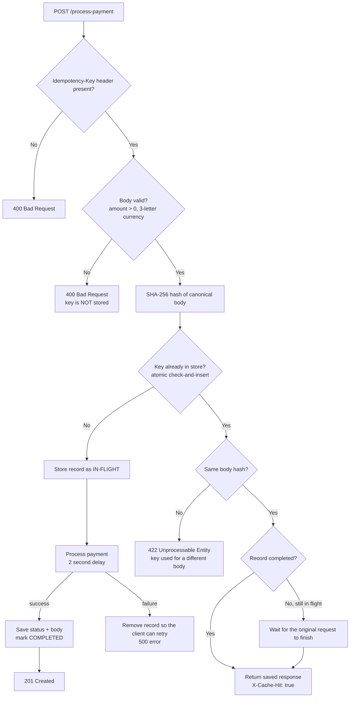
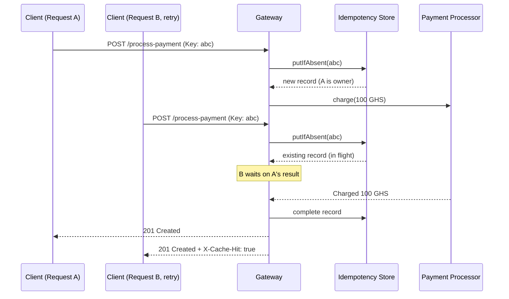

# Idempotency Gateway — "Pay-Once" Protocol

A small payment API for FinSafe Transactions that guarantees a payment is processed **exactly once**, no matter how many times a client retries the same request.

Built with **Java 21 + Spring Boot 3**. Storage is an in-memory `ConcurrentHashMap`.

---

## Architecture Diagram



### Sequence: two identical requests arriving at the same time



---

## Setup Instructions

**Requirements:** Java 21, Maven 3.8+

```bash
git clone https://github.com/Cycy-e/AmaliTech-DEG-Project-based-challenges.git
cd AmaliTech-DEG-Project-based-challenges/backend/Idempotency-gateway

# start the server (runs on http://localhost:8080)
mvn spring-boot:run

# run the tests
mvn test
```

To build a jar instead:

```bash
mvn clean package
java -jar target/idempotency-gateway-1.0.0.jar
```

Use a different port with `PORT=9090 mvn spring-boot:run`.

### Configuration (`src/main/resources/application.properties`)

| Property | Default | Meaning |
|---|---|---|
| `payment.processing-delay-ms` | `2000` | Simulated processing time |
| `idempotency.key-ttl` | `24h` | How long a key is remembered after the payment completes |
| `idempotency.cleanup-interval` | `60000` | How often (ms) expired keys are removed |

---

## API Documentation

### `POST /process-payment`

**Headers**

| Header | Required | Description |
|---|---|---|
| `Idempotency-Key` | Yes | Unique string per payment (max 255 chars). A UUID is recommended. |
| `Content-Type` | Yes | `application/json` |

**Body**

```json
{ "amount": 100, "currency": "GHS" }
```

- `amount`: number greater than 0
- `currency`: 3-letter uppercase ISO code (e.g. `GHS`, `USD`)

### Responses

| Situation | Status | Notes |
|---|---|---|
| First request | `201 Created` | Payment processed (takes ~2s) |
| Retry with same key + same body | `201 Created` | Same body as the first response, returned instantly, header `X-Cache-Hit: true` |
| Retry while the first is still processing | `201 Created` | Waits for the first request, then returns its result with `X-Cache-Hit: true` |
| Same key, different body | `422 Unprocessable Entity` | `Idempotency key already used for a different request body.` |
| Missing / too long key | `400 Bad Request` | |
| Invalid body | `400 Bad Request` | e.g. negative amount, bad currency, malformed JSON |

### Examples

**1. First payment**

```bash
curl -i -X POST http://localhost:8080/process-payment \
  -H "Content-Type: application/json" \
  -H "Idempotency-Key: order-1001" \
  -d '{"amount": 100, "currency": "GHS"}'
```

```
HTTP/1.1 201
Content-Type: application/json

{
  "status": "success",
  "message": "Charged 100 GHS",
  "transactionId": "5b1f7c3e-2a7d-4a39-9a51-0e6b1f0f7f21",
  "amount": 100,
  "currency": "GHS",
  "processedAt": "2026-11-19T20:45:12.331Z"
}
```

**2. Retry (same key, same body)**: returns immediately with the same `transactionId`

```
HTTP/1.1 201
X-Cache-Hit: true
Content-Type: application/json

{ "status": "success", "message": "Charged 100 GHS", "transactionId": "5b1f7c3e-...", ... }
```

**3. Same key, different amount**

```bash
curl -i -X POST http://localhost:8080/process-payment \
  -H "Content-Type: application/json" \
  -H "Idempotency-Key: order-1001" \
  -d '{"amount": 500, "currency": "GHS"}'
```

```
HTTP/1.1 422
{ "status": "error", "error": "Idempotency key already used for a different request body." }
```

**4. Concurrent requests**: run this in two terminals at the same time. Only one payment is processed and both get the same `transactionId`.

```bash
curl -i -X POST http://localhost:8080/process-payment \
  -H "Content-Type: application/json" \
  -H "Idempotency-Key: order-2002" \
  -d '{"amount": 50, "currency": "USD"}'
```

---

## Design Decisions

- **Atomic check-and-insert.** The store uses `ConcurrentHashMap.compute()`, which locks per key. Two requests with the same key can never both decide they are "first". This is what prevents the race condition. A plain `get()` followed by `put()` would leave a gap where both requests slip through.

- **In-flight handling with `CompletableFuture`.** Each record holds a future for the result. The first request completes it once the charge is done; any duplicate that arrives while it's still running simply blocks on the same future. No polling and no second charge. The waiting request gets the original's response, not a 409.

- **Body fingerprint = SHA-256 of canonical JSON.** Keys are sorted before hashing, so `{"amount":100,"currency":"GHS"}` and `{"currency":"GHS","amount":100}` are treated as the same request. Storing a hash instead of the full body keeps memory small.

- **Failed payments don't lock the key.** If processing throws an error, the record is removed so the client can retry with the same key. Only successful results are cached.

- **Validation happens before the key is stored.** A request with a bad body (e.g. negative amount) gets a 400 and does not use up the key, so the client can fix the body and retry.

- **422 for key reuse.** The request is syntactically fine but semantically conflicts with an earlier one, which matches the meaning of 422. Stripe uses the same approach.

- **In-memory store.** Fine for this challenge and a single instance. In production this would move to Redis (`SET key value NX PX ttl`) so multiple API instances share the same view of keys.

### Project structure

```
src/main/java/com/finsafe/gateway/
├── controller/   PaymentController, ApiExceptionHandler
├── service/      IdempotencyService (core logic), PaymentProcessor (simulated bank)
├── store/        IdempotencyStore, IdempotencyRecord
└── model/        PaymentRequest, StoredResponse
```

---

## The Developer's Choice: Key Expiry (TTL)

**What:** Every idempotency key expires 24 hours after its payment completes (configurable). A scheduled job runs every minute and removes expired keys. Keys that are still being processed are never removed.

**Why:**

1. **Memory safety.** Without expiry, the store grows forever. A busy processor handling millions of payments a day would eventually run out of memory and crash, which is the worst outcome for a payment system.
2. **It matches real-world practice.** Retries happen within seconds or minutes of a timeout, not weeks later. Stripe, for example, keeps idempotency keys for 24 hours. After that window a key can safely be reused.
3. **Easy to move to Redis.** The TTL model maps directly onto Redis key expiry, so the move to a distributed store needs no change in behaviour.

**Also added:** input validation (`amount > 0`, valid 3-letter currency, key length ≤ 255) so garbage requests are rejected before they reach the payment logic.
